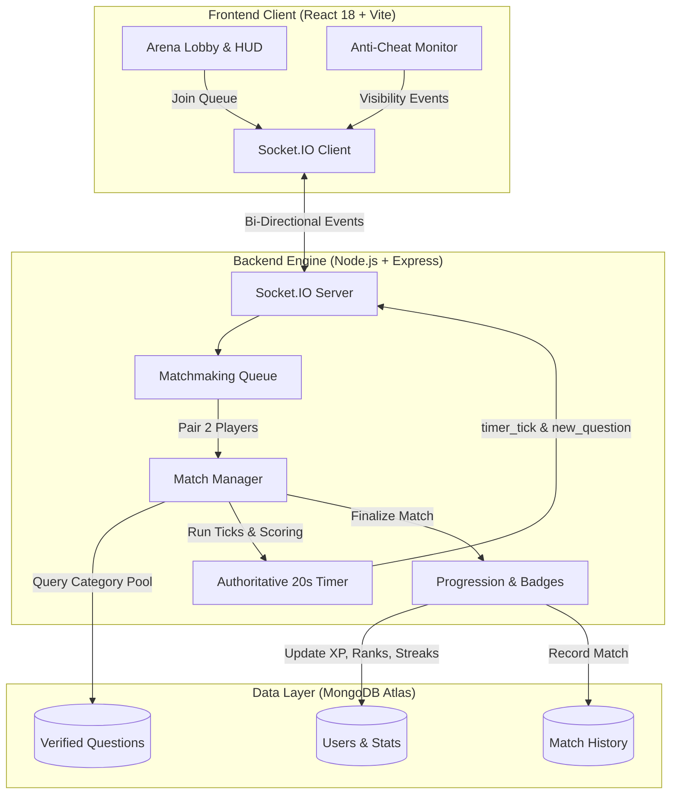

# ⚔️ SkillDuels — Real-Time 1v1 Competitive Learning & Quiz Battle Platform

<div align="center">

[](https://github.com/imunmesh/Skill-Duels/actions)
[](https://opensource.org/licenses/ISC)
[](#)
[](#)
[](#)
[](#)
[](#)
[](#)

<p align="center">
  <strong>Master technical skills under live competitive pressure.</strong><br>
  Real-time 1v1 multiplayer duels, server-authoritative countdowns, dynamic speed bonuses, anti-cheat protection, daily streak tracking, and competitive rank tiers.
</p>

[Explore Documentation](#-documentation-hub) • [Quickstart Guide](#-quickstart--local-setup) • [Architecture](#-system-architecture) • [API & Sockets](#-api--socketio-specifications)

</div>

---

## 📖 Overview

**SkillDuels** is an esports-inspired gamified web platform designed for software engineers, students, and competitive learners. Players face off in head-to-head 1v1 battles across specialized domains—including **Data Structures & Algorithms**, **Web Development**, **Machine Learning**, **Core CS Fundamentals**, and **Logical Aptitude**.

Unlike traditional asynchronous quizzes, every duel in SkillDuels runs on a synchronized, server-authoritative engine that broadcasts identical question sets simultaneously, enforces real-time countdown clocks, applies sub-second speed bonuses, detects unauthorized tab switching, and dynamically awards XP, rank tiers, and achievement badges.

---

## ✨ Key Platform Features

### 1. ⚡ Real-Time 1v1 Matchmaking Engine
- **Category-Isolated Matchmaking:** Queue for specialized domains (DSA, Machine Learning, Web Dev, Technical & CS, Logical Reasoning).
- **Sub-Second Pairing:** Lightweight Socket.IO rooms pair peers instantaneously when queueing in the same topic.
- **Strict Content Validation:** Ensures rooms only spawn when verified pools contain $\ge 5$ active questions, guaranteeing category isolation with zero cross-leakage.

### 2. ⏱️ Server-Authoritative 20-Second Battle Clock
- **Tamper-Proof Timers:** Countdown execution happens exclusively on the Node.js server (`setInterval` with 1000ms delta ticks).
- **Auto-Advance & Round Intermission:** Answers close immediately at 0s, revealing correct answers in emerald green alongside a 3-second intermission before advancing to the next round.
- **State Synchronization:** Automatic client reconnect hydration (`match_sync`) allows interrupted duelists to recover active round state without desync.

### 3. 🎯 Dynamic Scoring with Speed Bonus
- **Scoring Formula:**
  $$\text{Points Earned} = \text{Base Points (100)} + \left(\text{Remaining Seconds} \times 2.5\right)$$
- Correct answers submitted within the first few seconds yield up to **+50 Speed Bonus** points (max 150 points per question).
- Live HUD broadcasts opponent points instantaneously upon submission without page refreshes.

### 4. 🛡️ Anti-Cheat Guardian
- **Live Tab & Focus Tracking:** Monitors browser `visibilitychange` and window `blur` events.
- **Three-Strike Disqualification:** Unfocused tabs trigger progressive warning toasts. Committing 3 violations results in automatic match forfeiture and a loss recorded.
- **Zero Client-Side Leakage:** Correct answers and explanations are stripped (`toClientJSON`) before dispatching payloads over the socket.

### 5. 🔄 Server-Authoritative Rematch System
- **15-Second Invitation Window:** Post-match Rematch button enters a 15-second countdown awaiting opponent acceptance.
- **Fair-Play Safeguards:** Mutual consent required; declines, timeouts, or disconnects gracefully terminate invitations.
- **Daily Cap:** Limits consecutive rematches to 5 per player-pair every 24 hours to prevent XP farming and collusion.

### 6. 🔥 Daily Participation Streaks (`Asia/Kolkata` Timezone)
- **Calendar-Day Streak Engine:** Tracks participation across true calendar days in Indian Standard Time (`Asia/Kolkata`).
- **Scaling Streak XP Bonus:** Grants $+10 \text{ XP}$ per streak day (capped at $+50 \text{ XP}$ per match).
- **Grace Periods & Expirations:** Playing consecutive calendar days increments streaks; missing a day resets active streaks to zero while preserving the lifetime longest record.

### 7. 🏆 Competitive Ranks & Achievement Badges
- **7 Canonical Ranks:**
  - 🥉 **Bronze** ($0 - 99 \text{ XP}$)
  - 🥈 **Silver** ($100 - 299 \text{ XP}$)
  - 🥇 **Gold** ($300 - 599 \text{ XP}$)
  - 🛡️ **Platinum** ($600 - 999 \text{ XP}$)
  - 💎 **Diamond** ($1,000 - 1,999 \text{ XP}$)
  - ⭐ **Ace** ($2,000 - 3,499 \text{ XP}$)
  - 👑 **Conqueror** ($3,500+ \text{ XP}$)
- **Milestone Badges:** Automatically unlocked for achievements such as *First Win*, *Lightning Reflexes* (answering with $\ge 17\text{s}$ remaining), *Flawless Victory*, *Honorable Duelist* (0 tab warnings), and *Unstoppable Legend* (7-day streak).

### 8. 📊 Live Leaderboards & Analytics
- Filter rankings across **Daily**, **Weekly**, and **All-Time** periods.
- Filter by category with podium cards for top duelist highlights.
- Detailed player profiles with win/loss records, match histories, and badge showcases.

### 9. 🛠️ Administrative CMS & Question Pool
- Full CRUD management for categories and question banks.
- Toggle question active states, difficulty levels (*easy*, *medium*, *hard*), custom timers, and points.
- Question count indicators ensure categories meet competitive thresholds before entering production rotation.

### 10. 🎨 Modern Cyberpunk UI & Micro-Interactions
- Smooth animations powered by **Framer Motion** and **Tailwind CSS**.
- Custom 3D perspective **Cube Loader** with neon face glows.
- Interactive **Tetris Loader** for post-authentication arena readiness.
- Neon 3D service cards featuring customized category artwork and hover micro-interactions.

---

## 🏗️ System Architecture



---

## 🛠️ Tech Stack

### Frontend Client
| Technology | Description |
|---|---|
| **React 18** | High-performance SPA with hooks, contexts, and reducers |
| **Vite 5** | Next-generation frontend build tooling and HMR |
| **Tailwind CSS 3** | Utility-first responsive styling and custom animations |
| **Framer Motion 14** | Production-ready spring physics and component animations |
| **Radix UI** | Accessible, unstyled UI primitives (dialogs, labels) |
| **Socket.IO Client 4** | Low-latency real-time WebSocket communication |
| **Lucide React** | Clean, consistent SVG icon system |

### Backend Server
| Technology | Description |
|---|---|
| **Node.js 18 / 20** | Asynchronous JavaScript runtime environment |
| **Express 4** | RESTful HTTP API framework and middleware stack |
| **Socket.IO 4** | Real-time event gateway with room isolation and heartbeats |
| **MongoDB & Mongoose 8** | Document database with compound indexing and validation |
| **JWT & BcryptJS** | Secure stateless authentication and salted password hashing |
| **Multer** | Avatar file upload and image disk storage handler |

### DevOps & Quality Assurance
| Technology | Description |
|---|---|
| **GitHub Actions** | Automated CI matrix (Node 18.x & 20.x, Linting, Unit & Acceptance Tests, Vite Build) |
| **ESLint & Prettier** | Code cleanliness, standard formatting, and syntax validation |
| **Render** | Continuous production deployment for full-stack web services |

---

## 📁 Repository Monorepo Structure

```
Skill duel/
├── .github/
│   └── workflows/
│       └── ci-cd.yml             # Automated GitHub Actions CI/CD pipeline
├── client/                       # React 18 + Vite SPA Frontend
│   ├── public/                   # Static assets & cropped category art
│   ├── src/
│   │   ├── components/           # Reusable components (HUD, Modals, Badges)
│   │   │   └── ui/               # UI components (ServiceCard, Loaders, AuthSwitch)
│   │   ├── constants/            # Canonical rules, tiers, categories
│   │   ├── context/              # Auth & Socket state providers
│   │   ├── pages/                # App views (Lobby, Match, Profile, Admin, Leaderboard)
│   │   └── index.css             # Tailwind base & custom animations
│   ├── index.html                # Entry HTML template
│   ├── package.json              # Client dependencies & build scripts
│   └── vite.config.js            # Vite configuration & proxy settings
├── server/                       # Node.js + Express + Socket.IO Backend
│   ├── src/
│   │   ├── config/               # Database connection & global constants
│   │   ├── controllers/          # Business logic (Auth, Questions, Leaderboard)
│   │   ├── middleware/           # Auth JWT verification & error handling
│   │   ├── models/               # Mongoose schemas (User, Category, Question, Match)
│   │   ├── routes/               # REST API route endpoints
│   │   ├── scripts/              # Automated acceptance & unit test suites
│   │   ├── services/             # Progression, streaks, XP, and rank logic
│   │   └── socket/               # MatchManager, Matchmaking, Rematch, QuestionService
│   ├── package.json              # Server dependencies & test runners
│   └── .eslintrc.json            # Strict ESLint configuration
├── docs/                         # Formal Engineering Specifications
│   ├── API_CONTRACT.md           # REST API endpoints & payload specifications
│   ├── SOCKET_EVENTS.md          # WebSocket event lifecycles and AC mappings
│   ├── QUIZ_CONTENT_TESTS.md     # Anti-cheat & question isolation test reports
│   └── DEMO_VIDEO_SCRIPT.md      # Live demonstration walkthrough script
├── package.json                  # Root monorepo workspace configuration
└── README.md                     # Comprehensive project documentation
```

---

## 🚀 Quickstart & Local Setup

### Prerequisites
- **Node.js**: `v18.0.0` or higher (v20.x recommended)
- **npm**: `v9.0.0` or higher
- **MongoDB**: Local MongoDB instance (`mongodb://127.0.0.1:27017/skillduels`) or a free [MongoDB Atlas](https://www.mongodb.com/atlas) connection URI.

### 1. Clone Repository & Install Dependencies
The repository is structured as an npm monorepo with root workspaces:

```bash
git clone https://github.com/imunmesh/Skill-Duels.git
cd Skill-Duels

# Install root, client, and server dependencies simultaneously
npm install
```

### 2. Configure Environment Variables

#### Backend (`server/.env`):
Create `server/.env` (or copy from `server/.env.example`):
```env
PORT=5000
NODE_ENV=development
MONGODB_URI=mongodb://127.0.0.1:27017/skillduels
JWT_SECRET=your_super_secret_jwt_key_at_least_32_characters_long
JWT_EXPIRES_IN=7d
CLIENT_URL=http://localhost:5173
```

#### Frontend (`client/.env`):
Create `client/.env`:
```env
VITE_API_URL=http://localhost:5000/api
VITE_SOCKET_URL=http://localhost:5000
```

### 3. Seed Database with Initial Content
Populate verified categories, 20-second battle questions, and an administrator account:

```bash
npm --prefix server run seed
```

> **Default Admin Account:**
> - **Email:** `admin@skillduels.com`
> - **Password:** `Admin123!`

### 4. Run Development Servers
You can run both server and client concurrently or independently:

```bash
# Run server (port 5000 with nodemon live-reloading)
npm run server

# In a separate terminal, run frontend (port 5173 with Vite HMR)
npm run client
```

Navigate to [http://localhost:5173](http://localhost:5173) in your browser.

---

## 🧪 Testing & Verification Suite

SkillDuels features a comprehensive, multi-layer automated test suite that verifies code quality, rank calculations, daily calendar streak tracking, rematch protocol limits, and strict category question isolation:

```bash
# 1. Run ESLint syntax & style checks
npm run lint

# 2. Run CI unit test suite (Rank progression, streaks, module health)
npm test

# 3. Run acceptance test suite for Calendar-Day Streak Tracking (11/11 tests)
npm --prefix server run test:streak

# 4. Run acceptance test suite for Rematch protocol & daily caps (9/9 tests)
npm --prefix server run test:rematch

# 5. Run acceptance test suite for Strict Question Category Isolation (7/7 tests)
npm --prefix server run test:strict

# 6. Verify production build of client SPA
npm run build:client
```

All 6 test suites pass with **100% success rate** and are enforced automatically on every commit via the GitHub Actions CI pipeline.

---

## 📡 API & Socket.IO Specifications

### Core REST Endpoints
| Method | Endpoint | Access | Purpose |
|---|---|---|---|
| `POST` | `/api/auth/register` | Public | Register new player account |
| `POST` | `/api/auth/login` | Public | Authenticate player and receive JWT token |
| `GET` | `/api/auth/me` | Authenticated | Retrieve authenticated player profile and stats |
| `GET` | `/api/categories` | Public | List all active duel categories with question counts |
| `GET` | `/api/leaderboard` | Public | Query top players by period (`daily`, `weekly`, `all-time`) |
| `GET` | `/api/profile/:userId` | Authenticated | Fetch public profile, stats, rank, and badge showcase |
| `POST` | `/api/profile/avatar` | Authenticated | Upload custom profile avatar image |
| `GET` | `/api/questions` | Admin Only | List, filter, and inspect question bank |
| `POST` | `/api/questions` | Admin Only | Create new verified question with 20s time limit |

### Real-Time Socket Events
| Event Name | Direction | Payload Description |
|---|---|---|
| `find_opponent` | Client &rarr; Server | Enqueue in matchmaking with `{ category }` |
| `match_found` | Server &rarr; Client | Pairing successful; dispatches room ID and opponent details |
| `new_question` | Server &rarr; Client | Dispatches active question `{ prompt, options, timeLimit: 20 }` |
| `timer_tick` | Server &rarr; Client | Authoritative 1s tick `{ questionIndex, remainingSeconds }` |
| `submit_answer` | Client &rarr; Server | Player submits `{ matchId, questionIndex, selectedOptionIndex }` |
| `score_update` | Server &rarr; Client | Live broadcast of updated scores to both duelists |
| `tab_warning` | Client &rarr; Server | Anti-cheat alert when player blurs or switches tabs |
| `match_ended` | Server &rarr; Client | Duel concluded with final scores, XP gains, and tier updates |
| `rematch_request` | Client &rarr; Server | Request a rematch with previous duel opponent |
| `rematch_decline` | Client &rarr; Server | Explicitly decline pending rematch invitation |

For complete schemas and payload examples, refer to [docs/SOCKET_EVENTS.md](./docs/SOCKET_EVENTS.md) and [docs/API_CONTRACT.md](./docs/API_CONTRACT.md).

---

## 📚 Documentation Hub

The `docs/` directory contains complete architecture, API contracts, and verification documentation:

- 📑 [**API Contract Specification**](./docs/API_CONTRACT.md) — Exhaustive REST endpoints, authentication headers, error codes, and request/response structures.
- ⚡ [**Socket.IO Event Specifications**](./docs/SOCKET_EVENTS.md) — Real-time event lifecycle, payload definitions, timeout handling, and anti-cheat triggers.
- 🛡️ [**Quiz Content & Isolation Tests**](./docs/QUIZ_CONTENT_TESTS.md) — Security evaluations, query filtering tests, and category leakage prevention proofs.
- 🎬 [**Live Demo Video Walkthrough Script**](./docs/DEMO_VIDEO_SCRIPT.md) — Step-by-step storyboard for live competitive battle demonstrations.
- 📌 [**Mid-Point Status Report**](./docs/MID_POINT_STATUS_NOTE.md) — Engineering milestones, requirement compliance (FR-01 through FR-10), and performance audit logs.

---

## 🤝 Contributing

1. Fork the Project repository
2. Create your Feature Branch (`git checkout -b feature/AmazingFeature`)
3. Ensure all tests and linting pass (`npm run lint && npm test`)
4. Commit your changes (`git commit -m 'feat: add amazing feature'`)
5. Push to the Branch (`git push origin feature/AmazingFeature`)
6. Open a Pull Request

---

## 📄 License

Distributed under the **ISC License**. See `LICENSE` for more information.

<div align="center">
  <sub>Built with ❤️ by the SkillDuels Engineering Team.</sub>
</div>
