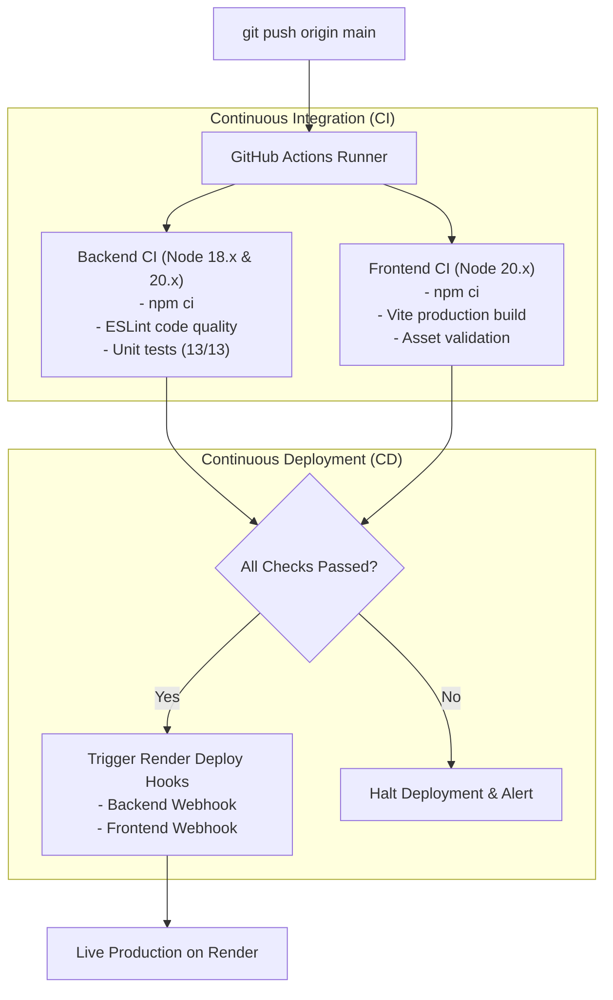

# SkillDuels CI/CD Pipeline Documentation

This project utilizes **GitHub Actions** for Continuous Integration (CI) and **Render Deploy Hooks** for Continuous Deployment (CD).

---

## 1. Pipeline Architecture

---

## 2. CI Jobs Overview

### Job 1: `backend-ci`
- **Matrix**: Node.js `18.x` and `20.x`
- **Steps**:
  1. `npm ci` (clean, reproducible dependency install)
  2. `npm run lint` (ESLint rule enforcement across `server/src/**/*.js`)
  3. `npm run test:unit` (13 automated unit tests covering rank calculation, streak calendar math, match manager state, and question service)

### Job 2: `frontend-ci`
- **Environment**: Node.js `20.x`
- **Steps**:
  1. `npm ci` (client dependencies)
  2. `npm run build` (Vite production bundle compilation)
  3. Validates that `client/dist/index.html` exists and bundles are valid.

---

## 3. Configuring Automated CD (Render Deploy Hooks)

To enable automatic instant deployments upon successful CI:

1. **Obtain Render Deploy Hooks**:
   - In Render Dashboard, go to your **Backend Service** $\rightarrow$ **Settings** $\rightarrow$ Scroll to **Deploy Hook** $\rightarrow$ Copy the Webhook URL.
   - Go to your **Frontend Static Site** $\rightarrow$ **Settings** $\rightarrow$ Scroll to **Deploy Hook** $\rightarrow$ Copy the Webhook URL.

2. **Add to GitHub Repository Secrets**:
   - In your GitHub repo (`imunmesh/Skill-Duels`), go to:
     **Settings $\rightarrow$ Secrets and variables $\rightarrow$ Actions $\rightarrow$ New repository secret**
   - Add:
     - `RENDER_BACKEND_DEPLOY_HOOK`: *(paste backend hook URL)*
     - `RENDER_FRONTEND_DEPLOY_HOOK`: *(paste frontend hook URL)*

Whenever code is pushed to `main`, GitHub Actions will verify tests and linting first, then automatically deploy to Render with zero manual steps!
